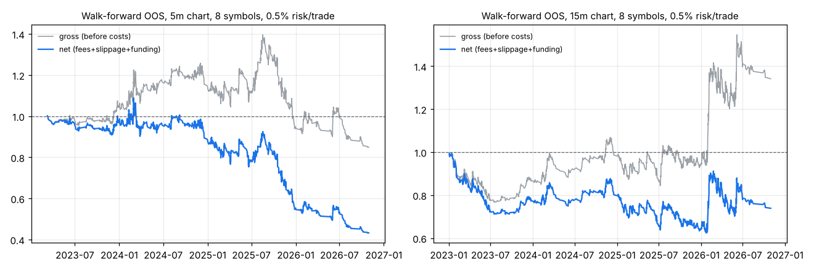
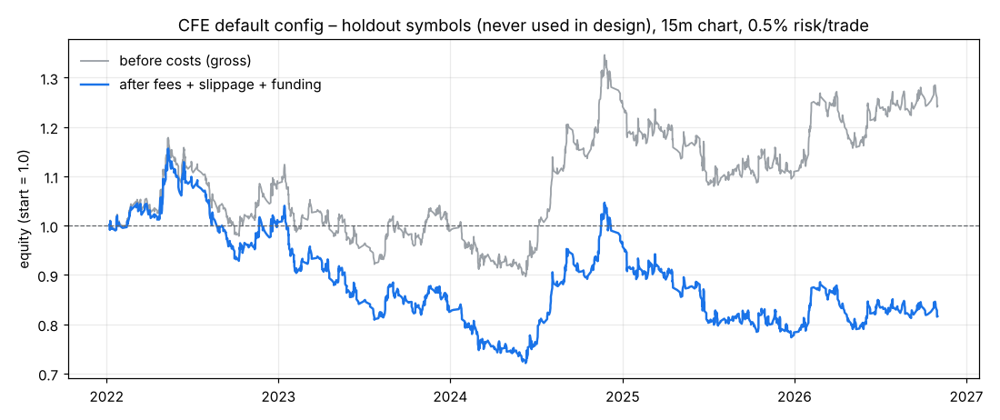
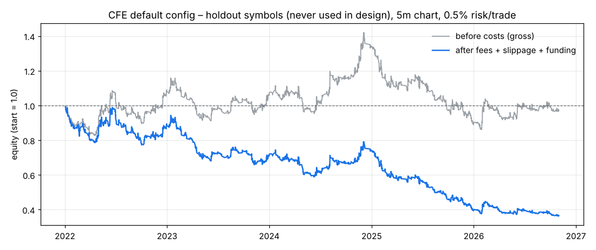

# FÁZA 5–6 – Validácia, walk-forward a optimalizácia

> **Zhrnutie v jednej vete:** CFE je funkčný, nerepaintujúci systém s presným plánom obchodu, ale na
> 24 kryptomenových futures pároch a ~12 miliónoch 5-minútových sviečok (2022–2026) **sa nepodarilo nájsť
> konfiguráciu so štatisticky preukázateľne kladnou očakávanou hodnotou po započítaní reálnych nákladov.**
> Na 15m je systém približne na nule pred nákladmi (+0,02 až +0,04 R/obchod) a mierne záporný po nich
> (≈ −0,02 R/obchod); na 5m je po nákladoch jednoznačne záporný (≈ −0,06 R/obchod, t ≈ −3).
>
> Žiadne číslo v tomto dokumente nie je odhadnuté ani upravené – všetky pochádzajú zo skriptov v `backtest/`
> a sú uložené v `results/` (JSON/CSV/PNG). Postup reprodukcie je v §10.

---

## 1. Dáta, metodika, predpoklady

| Položka | Hodnota |
|---|---|
| Zdroj | Binance USDⓈ-M perpetual futures, verejný archív `data.binance.vision` |
| Dáta | 5m sviečky 2022-01-01 → 2026-10-31 (≈ 508 000 sviečok / pár), vrátane **skutočného taker-buy objemu**; historické funding rates |
| Páry – návrh + walk-forward (8) | BTC, ETH, SOL, BNB, XRP, DOGE, LINK, AVAX |
| **Holdout-1 (8)** – nikdy nepoužité pri návrhu ani WF | ADA, LTC, DOT, ATOM, NEAR, FIL, TRX, ETC |
| **Holdout-2 (8)** – pre-registrovaný test | UNI, AAVE, XLM, ALGO, SAND, AXS, EGLD, VET |
| Grafové TF | 5m (natívne), 15m a 1h (agregované z 5m); HTF 15m/1h/4h/1D z 5m |
| Poplatky | taker 0,05 %, maker 0,02 % (Binance VIP0), slippage 0,02 % na každý market fill |
| Funding | skutočné historické sadzby pre každý funding okamih, keď je pozícia otvorená |
| Vstup | limit: plnenie len ak cena prejde **cez** limit (prísnejšie ako dotyk); market: close signálnej sviečky |
| Cesta ceny v sviečke | ako TradingView broker emulator: open → bližší extrém → vzdialenejší → close |
| Zmena SL (BE/lock/trail) | platí od nasledujúcej sviečky (ako v Pine) |
| Pozície | 1 pozícia na pár naraz; výsledky v R (R = vzdialenosť entry–SL) |
| Equity / DD | 0,5 % rizika na obchod, obchody všetkých párov v časovom poradí (zjednodušenie – prekrývajúce sa obchody nie sú modelované ako portfólio) |

**Overenie implementácie**
* `tests/test_no_lookahead.py` – engine na dátach orezaných v čase *t* musí dať identické hodnoty (setupy, ceny, skóre, HTF alignment, štruktúra) pre všetky sviečky < *t*. **Prešiel** (5m aj 15m). Negatívna kontrola: úmyselne vložený HTF repaint test **zhodil** („score_l differs … look-ahead!“).
* `tests/test_simulator_crosscheck.py` – numba simulátor vs. nezávislá jednoduchá implementácia pravidiel (limit fill, partials, BE, lock): zhoda gross R na > 100 obchodoch. **Prešiel.**
* `tools/lint_pine.py` – statická kontrola Pine skriptov nad syntaktickým stromom (nedefinované/neskôr deklarované premenné, duplicitné deklarácie, polia vlastných typov, argumenty funkcií, whitelist built-in funkcií, zmeny v Pine v6). 0 chýb na všetkých troch skriptoch; negatívne kontroly (8 typov úmyselne vložených chýb) zachytené všetky. Nenahrádza kompiláciu v TradingView – TradingView kompilátor nebol z prostredia dostupný.
* `tools/build_replay.py` – na skutočnom okne overí, že scenár (▲ LONG / ▼ SHORT trigger) na predchádzajúcej sviečke presne zodpovedal vstupu každého signálu.

## 2. Návrhové obdobie (2022-01 – 2023-06): pôvodný „klasický“ konfluenčný engine v1

Trojica triggerov (sweep & reclaim, BOS/CHoCH, pullback), ručne vážené skóre zo 7 vrstiev, SL z 5 sviečok, market vstup:

| TF | Trigger | Kandidáti | Gross R | Náklady R | Net R |
|---|---|---|---|---|---|
| 5m | sweep & reclaim | 25 624 | −0,006 | 0,488 | **−0,495** |
| 5m | BOS/CHoCH break | 28 228 | −0,009 | 0,246 | −0,255 |
| 5m | pullback | 171 362 | −0,008 | 0,329 | −0,337 |
| 15m | sweep & reclaim | 9 332 | −0,068 | 0,258 | −0,325 |
| 15m | BOS/CHoCH break | 9 010 | −0,016 | 0,129 | −0,144 |
| 15m | pullback | 54 006 | −0,010 | 0,180 | −0,190 |
| 1h | sweep & reclaim | 2 309 | −0,025 | 0,115 | −0,139 |
| 1h | BOS/CHoCH break | 2 113 | −0,026 | 0,057 | −0,084 |
| 1h | pullback | 11 971 | −0,016 | 0,084 | −0,101 |

**Rank-korelácia (Spearman) jednotlivých vrstiev s gross výsledkom obchodu** – všetky prakticky nulové:

| TF | trend | štruktúra | objem | momentum | likvidita | volatilita | room | RVOL | tlak | RSI | ATR pct | SL % |
|---|---|---|---|---|---|---|---|---|---|---|---|---|
| 5m | 0,008 | −0,003 | −0,016 | −0,013 | 0,000 | −0,000 | 0,003 | −0,006 | −0,020 | −0,019 | 0,002 | −0,037 |
| 15m | 0,016 | −0,019 | −0,022 | 0,010 | −0,014 | −0,007 | −0,002 | −0,014 | −0,023 | −0,007 | −0,018 | −0,040 |
| 1h | 0,003 | −0,007 | −0,010 | 0,015 | 0,009 | −0,041 | 0,028 | 0,014 | −0,035 | −0,023 | −0,057 | −0,058 |

Gross R podľa decilov ručne váženého skóre (D1 = najnižšie, D10 = najvyššie) – bez monotónneho vzťahu:

| TF | D1 | D2 | D3 | D4 | D5 | D6 | D7 | D8 | D9 | D10 |
|---|---|---|---|---|---|---|---|---|---|---|
| 5m | −0,002 | −0,001 | −0,020 | −0,022 | −0,020 | −0,028 | −0,001 | −0,004 | −0,000 | 0,017 |
| 15m | −0,039 | −0,013 | −0,007 | −0,025 | −0,039 | −0,015 | −0,015 | −0,017 | 0,012 | −0,026 |
| 1h | −0,031 | −0,028 | −0,026 | −0,014 | −0,035 | −0,038 | 0,031 | −0,017 | −0,039 | 0,010 |

**Záver §2:** SMC/TA prvky (sweep, FVG, OB, RVOL, RSI, MACD…) v tejto forme nenesú merateľnú informáciu o výsledku obchodu; dominantným faktorom sú **náklady** (na 5m 0,25–0,49 R na obchod).

## 3. Návrhové obdobie: engine v2 (displacement break + HTF + štrukturálny SL)

Výber z tabuľky `results/design_study.json → v2_grid` (P333 = 33/33/34 % na TP1/2/3 + BE; P050 = 100 % na 2R):

| HTF prah | TF | Vstup | Výstup | n | Gross R | Náklady R | Net R |
|---|---|---|---|---|---|---|---|
| žiadny | 5m | market | P333 | 39 591 | −0,002 | 0,151 | −0,153 |
| žiadny | 5m | limit retest | P333 | 30 764 | 0,005 | 0,108 | −0,102 |
| 1,0 | 5m | market | P333 | 4 257 | 0,064 | 0,134 | −0,071 |
| 1,0 | 5m | limit retest | P050 | 3 212 | 0,096 | 0,090 | **+0,004** |
| 1,0 | 5m | limit retest | P333 | 3 212 | 0,078 | 0,095 | −0,018 |
| 1,0 | 15m | market | P050 | 2 200 | 0,111 | 0,071 | **+0,037** |
| 1,0 | 15m | limit retest | P333 | 1 614 | 0,048 | 0,053 | −0,007 |

Ale rozklad na long/short (HTF = 1,0) odhalil, že „edge“ v návrhovom období je **režimový** (2022 = medvedí trh):

| TF | Vstup | Smer | n | Gross R | Net R |
|---|---|---|---|---|---|
| 5m | limit retest | short | 6 726 | +0,135 | +0,040 |
| 5m | limit retest | long | 2 910 | −0,035 | −0,134 |
| 15m | market | short | 4 581 | +0,124 | +0,049 |
| 15m | market | long | 2 019 | −0,022 | −0,099 |

**Kalibrácia skóre** (ridge regresia, tréning 2022 → validácia 2023-H1): rank-korelácia predikcie s výsledkom na validácii **−0,004 až +0,075**. Jediný konzistentne kladný koeficient mala vrstva **trend** (+0,03 až +0,04). → váhy v2: trend 45, ostatné 10–15, room 0.

## 4. Walk-forward analýza (rolling 12 mesiacov tréning → 6 mesiacov test, 8 okien, 2023-01 – 2026-10)

Mriežka 144 kombinácií na okno: HTF sada {15m/1h/4h, +1D} × HTF prah {0,5; 1,0} × vstup {limit, market} × výstup {P050, P333, P3TR} × min. skóre {0, 60, 70} × session filter {off, on}. Výber na tréningu: t-štatistika net R (min. 150 obchodov), spoločné parametre pre všetkých 8 párov.

### 5m – vybraté parametre a výsledky v testovacích oknách

| Test | Tréning | Vybratá konfigurácia | Tréning n | Tréning R | Test n | **Test R** |
|---|---|---|---|---|---|---|
| 2023-01..06 | 2022-01..12 | 1D, HTF 1,0, limit, P333, skóre ≥0, session | 529 | +0,148 | 57 | −0,163 |
| 2023-07..12 | 2022-07..2023-06 | 1D, HTF 1,0, limit, P333, skóre ≥0, session | 216 | +0,065 | 143 | +0,025 |
| 2024-01..06 | 2023-01..12 | 1D, HTF 1,0, limit, P050, skóre ≥70 | 369 | +0,083 | 318 | −0,003 |
| 2024-07..12 | 2023-07..2024-06 | 1D, HTF 1,0, limit, P050, session | 317 | +0,138 | 183 | −0,081 |
| 2025-01..06 | 2024-01..12 | base, HTF 1,0, limit, P3TR, ≥70, session | 669 | +0,014 | 309 | −0,078 |
| 2025-07..12 | 2024-07..2025-06 | base, HTF 1,0, market, P050, ≥70, session | 702 | +0,041 | 383 | −0,181 |
| 2026-01..06 | 2025-01..12 | 1D, HTF 1,0, limit, P3TR, ≥70, session | 279 | −0,022 | 230 | −0,018 |
| 2026-07..10 | 2025-07..2026-06 | 1D, HTF 1,0, market, P050, ≥60 | 752 | +0,071 | 61 | −0,682 |

### 15m – vybraté parametre a výsledky v testovacích oknách

| Test | Vybratá konfigurácia | Tréning n | Tréning R | Test n | **Test R** |
|---|---|---|---|---|---|
| 2023-01..06 | 1D, HTF 0,5, limit, P050, ≥60, session | 555 | +0,177 | 235 | −0,269 |
| 2023-07..12 | 1D, HTF 1,0, market, P333, ≥70, session | 187 | +0,063 | 107 | +0,125 |
| 2024-01..06 | 1D, HTF 1,0, market, P050, ≥70, session | 157 | +0,181 | 123 | +0,008 |
| 2024-07..12 | 1D, HTF 1,0, market, P050, ≥70, session | 219 | +0,161 | 112 | +0,056 |
| 2025-01..06 | base, HTF 1,0, market, P333, ≥70, session | 463 | +0,051 | 228 | −0,159 |
| 2025-07..12 | base, HTF 0,5, market, P333, ≥70, session | 697 | +0,014 | 319 | −0,017 |
| 2026-01..06 | base, HTF 0,5, market, P050, ≥70 | 958 | +0,010 | 510 | +0,086 |
| 2026-07..10 | 1D, HTF 1,0, limit, P050, ≥70, session | 238 | +0,148 | 28 | −0,444 |

Typický vzor preoptimalizovania: **tréningové R sú systematicky kladné, testovacie okolo nuly alebo záporné.**

### Agregát OOS

| Test | Obchody | Win rate | Gross R | Náklady R | Funding R | **Net R/obchod** | PF | t-stat | Σ R | Max DD* | Ø držanie | Long / Short R |
|---|---|---|---|---|---|---|---|---|---|---|---|---|
| WF 5m – celé OOS 2023–2026 | 1684 | 40,0 % | −0,015 | 0,076 | 0,0041 | **−0,095** | 0,85 | −3,03 | −160,7 | −60,3 % | 5,6 h | −0,003 / −0,187 |
| WF 5m – čisté OOS 2023-07+ | 1627 | 39,6 % | −0,013 | 0,076 | 0,0042 | **−0,093** | 0,86 | −2,89 | −151,4 | −60,3 % | 5,6 h | −0,005 / −0,183 |
| WF 15m – celé OOS 2023–2026 | 1662 | 40,3 % | +0,040 | 0,067 | 0,0044 | **−0,032** | 0,95 | −0,97 | −53,1 | −37,6 % | 19,1 h | −0,020 / −0,042 |
| WF 15m – čisté OOS 2023-07+ | 1427 | 42,6 % | +0,081 | 0,068 | 0,0050 | **+0,007** | 1,01 | 0,20 | +10,2 | −28,8 % | 20,0 h | +0,027 / −0,010 |

\* Max DD pri 0,5 % riziku na obchod (sekvenčne cez všetky páry).

Rozptyl OOS výsledkov všetkých 144 konfigurácií: 5m od −0,120 do +0,010 R (medián −0,062; kladné 3/144), 15m od −0,105 do +0,022 R (medián −0,047; kladné 2/144).



### Marginálne efekty (priemer OOS R cez ostatné dimenzie) – podklad pre optimalizáciu defaultov

| Dimenzia | 5m | 15m | Rozhodnutie |
|---|---|---|---|
| HTF sada: base vs +1D | −0,071 vs −0,083 | −0,047 vs −0,063 | **base** (15m/1h/4h) |
| HTF prah: 0,5 vs 1,0 | −0,086 vs −0,048 | −0,057 vs −0,047 | **1,0** |
| Vstup: market vs limit | −0,079 vs −0,073 | −0,059 vs −0,047 | **limit retest** |
| Výstup: P050 / P333 / P3TR | −0,068 / −0,081 / −0,078 | −0,054 / −0,051 / −0,057 | **P333** (požadované TP1/2/3; rozdiely sú v šume) |
| Min. skóre: 0 / 60 / 70 | −0,081 / −0,077 / −0,069 | −0,061 / −0,059 / −0,037 | **70** |
| Session filter: off vs on (13–24 UTC) | −0,080 vs −0,069 | −0,062 vs −0,040 | **on** |

Tieto smery sú konzistentné na oboch TF, ale **ani ich kombinácia neprináša kladnú očakávanú hodnotu**. Tieto defaulty boli **zafixované pred** testom na holdout pároch.

## 5. Pre-registrovaná default konfigurácia na nových pároch (holdout-1 a holdout-2)

Default = HTF 15m/1h/4h, prah 1,0, limit retest, P333 (33/33/34 %, BE po TP1, lock po TP2), skóre ≥ 70, session 13–24 UTC. **Presne tieto hodnoty sú defaulty v Pine skriptoch.**

| Test | Obchody | Win rate | Gross R | Náklady R | Funding R | **Net R/obchod** | PF | t-stat | Σ R | Max DD* | Ø držanie | Long / Short R |
|---|---|---|---|---|---|---|---|---|---|---|---|---|
| Default 5m – WF páry 2023-07+ (výber ovplyvnený) | 1998 | 51,0 % | +0,022 | 0,068 | 0,0026 | **−0,049** | 0,91 | −1,93 | −97,0 | −46,9 % | 4,5 h | +0,006 / −0,101 |
| **Default 5m – HOLDOUT-1** | 2905 | 50,0 % | +0,001 | 0,064 | 0,0032 | **−0,066** | 0,88 | −3,18 | −192,6 | −63,8 % | 4,2 h | −0,085 / −0,056 |
| **Default 5m – HOLDOUT-2** | 3236 | 50,5 % | +0,006 | 0,062 | 0,0029 | **−0,059** | 0,89 | −2,99 | −189,6 | −72,5 % | 4,2 h | −0,108 / −0,037 |
| Default 15m – WF páry 2023-07+ (výber ovplyvnený) | 1203 | 51,3 % | +0,041 | 0,048 | 0,0037 | **−0,011** | 0,98 | −0,33 | −13,2 | −22,8 % | 13,0 h | +0,012 / −0,035 |
| **Default 15m – HOLDOUT-1** | 1733 | 50,9 % | +0,028 | 0,045 | 0,0039 | **−0,020** | 0,96 | −0,74 | −35,0 | −37,6 % | 12,6 h | −0,089 / +0,019 |
| **Default 15m – HOLDOUT-2** | 1868 | 50,2 % | +0,021 | 0,039 | 0,0031 | **−0,021** | 0,96 | −0,78 | −38,5 | −31,8 % | 12,5 h | −0,018 / −0,022 |

Výsledky na dvoch nezávislých sadách nových párov sú **takmer identické** → zistenie je stabilné: 5m ≈ −0,06 R/obchod, 15m ≈ −0,02 R/obchod (štatisticky nerozlíšiteľné od nuly, t ≈ −0,8). Win rate ≈ 50 % pri priemernej výhre ≈ 0,95–1,0 R a priemernej strate ≈ −1,06 R.

Dôvody výstupu (holdout-1): 5m – SL 1453, stop po TP (BE/lock) 1088, TP3 363; 15m – SL 851, stop po TP 644, TP3 237.




### 5.1 Podľa roka (holdout-1)

**15m**

| Rok | Obchody | Win rate | Net R | Gross R | PF | Σ R | Long R | Short R |
|---|---|---|---|---|---|---|---|---|
| 2022 | 352 | 51,1 % | +0,007 | 0,050 | 1,01 | +2,4 | −0,290 | +0,074 |
| 2023 | 359 | 48,5 % | −0,107 | −0,049 | 0,80 | −38,6 | −0,165 | −0,032 |
| 2024 | 366 | 53,6 % | +0,085 | 0,128 | 1,17 | +31,1 | +0,001 | +0,158 |
| 2025 | 388 | 47,9 % | −0,100 | −0,055 | 0,82 | −38,9 | +0,058 | −0,151 |
| 2026 | 268 | 54,5 % | +0,034 | 0,087 | 1,07 | +9,0 | −0,094 | +0,103 |

**5m**

| Rok | Obchody | Win rate | Net R | Gross R | PF | Σ R | Long R | Short R |
|---|---|---|---|---|---|---|---|---|
| 2022 | 668 | 50,7 % | −0,034 | 0,026 | 0,94 | −22,6 | −0,229 | +0,012 |
| 2023 | 521 | 50,9 % | −0,078 | −0,001 | 0,85 | −40,7 | −0,125 | −0,009 |
| 2024 | 609 | 52,9 % | +0,014 | 0,077 | 1,03 | +8,4 | +0,079 | −0,036 |
| 2025 | 653 | 44,3 % | −0,186 | −0,118 | 0,69 | −121,3 | −0,160 | −0,193 |
| 2026 | 454 | 52,2 % | −0,036 | 0,036 | 0,93 | −16,5 | −0,098 | −0,003 |

### 5.2 Podľa trhového režimu (holdout-1; režim = 30-dňový výnos páru, volatilita = 30-dňová realizovaná vs. medián)

| Režim | 15m obchody | 15m Net R | 15m PF | 5m obchody | 5m Net R | 5m PF |
|---|---|---|---|---|---|---|
| Bull (30d > +15 %) | 404 | −0,115 | 0,79 | 728 | −0,066 | 0,88 |
| Bear (30d < −15 %) | 639 | −0,014 | 0,97 | 1157 | −0,057 | 0,89 |
| Sideways | 690 | +0,029 | 1,06 | 1020 | −0,077 | 0,86 |
| High volatility | 824 | −0,078 | 0,86 | 1496 | −0,111 | 0,80 |
| Low volatility | 909 | +0,032 | 1,06 | 1409 | −0,018 | 0,96 |

Pozorovanie „nízka volatilita je lepšia“ sa opakovalo aj na WF pároch, preto bolo otestované ako **pre-registrovaná hypotéza na holdout-2** (§7) – **nepotvrdilo sa**.

### 5.3 Podľa páru (holdout-1, 15m)

| Pár | Obchody | Win rate | Net R | PF | Σ R | Max DD |
|---|---|---|---|---|---|---|
| ADA | 237 | 53,2 % | +0,022 | 1,04 | +5,1 | −8,2 % |
| ATOM | 228 | 55,3 % | +0,026 | 1,05 | +5,9 | −7,4 % |
| DOT | 248 | 50,8 % | −0,031 | 0,94 | −7,7 | −11,0 % |
| ETC | 225 | 52,0 % | +0,023 | 1,04 | +5,1 | −9,6 % |
| FIL | 223 | 48,0 % | −0,029 | 0,95 | −6,4 | −10,1 % |
| LTC | 211 | 50,7 % | −0,071 | 0,86 | −15,0 | −15,0 % |
| NEAR | 224 | 46,4 % | −0,105 | 0,81 | −23,4 | −14,5 % |
| TRX | 137 | 50,4 % | +0,011 | 1,02 | +1,5 | −10,7 % |

### 5.4 Citlivosť na náklady (holdout-1)

| Náklady (taker / maker + slippage) | 15m Net R | 15m PF | 15m t | 5m Net R | 5m PF | 5m t |
|---|---|---|---|---|---|---|
| 0,05 / 0,02 + 0,02 (Binance VIP0) | −0,020 | 0,96 | −0,74 | −0,066 | 0,88 | −3,18 |
| 0,04 / 0,016 + 0,01 | −0,010 | 0,98 | −0,36 | −0,058 | 0,89 | −2,92 |
| 0,02 / 0,00 + 0,01 (nízke/VIP) | +0,013 | 1,03 | 0,47 | −0,023 | 0,96 | −1,17 |
| **0 (gross)** | **+0,025** | 1,05 | 0,92 | +0,003 | 1,01 | 0,13 |

Ani pri nulových nákladoch nie je výsledok štatisticky významný. (Počet obchodov sa mierne mení, lebo cost filter závisí od nákladov.)

## 6. Kalibrácia pásiem skóre (holdout-1, nezávislé výsledky všetkých setupov s default filtrami)

| Pásmo | 15m setupy | 15m Win rate | 15m Net R | 15m t | 5m setupy | 5m Net R | 5m t |
|---|---|---|---|---|---|---|---|
| NO TRADE (<50) | 0 | – | – | – | 0 | – | – |
| WEAK (50–64) | 77 | 46,8 % | −0,118 | −0,92 | 49 | −0,044 | −0,29 |
| VALID (65–79) | 1 501 | 50,8 % | −0,037 | −1,27 | 2 470 | −0,045 | −1,97 |
| STRONG (80–89) | 753 | 48,3 % | −0,050 | −1,18 | 1 591 | −0,076 | −2,69 |
| HIGH-CONVICTION (90+) | 51 | 49,0 % | −0,134 | −0,91 | 96 | −0,078 | −0,67 |

Spearman(skóre, výsledok): 15m 0,067, 5m 0,027. **Vyššie pásmo neznamená vyššiu očakávanú hodnotu.** Pásma sú preto v indikátore ponechané ako popis miery konfluencie (požiadavka zadania), s výslovným upozornením v tooltipe dashboardu, že nejde o pravdepodobnosť úspechu. Hodnota min. skóre 70 je zvolená podľa WF marginálov (§4), nie podľa týchto pásiem.

## 7. Pre-registrovaný test filtra nízkej volatility (holdout-2)

Pre-registrácia: `results/PREREGISTRATION_holdout2.md` (zapísaná pred spustením). Filter: 30-dňová volatilita denných výnosov (predošlý uzavretý deň) < jej 365-dňový medián.

| Konfigurácia | 5m Net R | 5m t | 15m Net R | 15m t |
|---|---|---|---|---|
| A – default | −0,059 | −2,99 | −0,021 | −0,78 |
| B – default + low-vol filter | −0,069 | −2,30 | −0,085 | −2,09 |

Rozhodovacie pravidlo 1 (B lepšie na oboch TF): **nesplnené → filter nebol prijatý.** Pravidlo 2 (Net R > 0 a t ≥ 2): **nesplnené pre žiadnu konfiguráciu.**

## 8. Kvalita odhadu buy/sell objemu (OHLC metóda) vs. skutočná taker delta (Binance, rok 2024, 5m)

| Pár | Sviečky | Korelácia delty na sviečke | Zhoda znamienka | Korelácia tlaku (10 sviečok) | (50 sviečok) |
|---|---|---|---|---|---|
| BTCUSDT | 105 408 | 0,547 | 71,1 % | 0,521 | 0,458 |
| SOLUSDT | 105 408 | 0,485 | 69,4 % | 0,500 | 0,388 |

Odhad zachytáva približne polovicu informácie o skutočnej delte. Preto je v indikátore vždy označený „est.“ a skutočnú deltu poskytuje iba footprint doplnok.

## 9. Závery a odporúčania

**Čo funguje (overené):**
1. Indikátor **nerepaintuje** a nepoužíva budúce dáta (overené testom aj negatívnou kontrolou na referenčnom engine).
2. Plán obchodu (entry/SL/TP/RR, invalidácia, náklady) je deterministický a zhodný medzi indikátorom, strategy a Python validáciou.
3. **HTF trend alignment** je jediný prvok s konzistentným (malým) prínosom; **limit retest + štrukturálny SL** znižuje náklady v R približne na polovicu oproti market vstupom s tesným SL.
4. Cost filter zabraňuje obchodom, kde by poplatky zjedli > 25 % rizika.

**Čo nefunguje (overené):**
1. Žiadna testovaná konfigurácia nemá štatisticky preukázateľne kladnú očakávanú hodnotu po nákladoch.
2. **5m scalping** s týmto systémom je po nákladoch jednoznačne stratový (t ≈ −3 na dvoch nezávislých holdout sadách). 1m/3m neboli testované, ale náklady v R by tam boli ešte vyššie.
3. Skóre 0–100 nerozlišuje kvalitu obchodov; pásma STRONG/HIGH-CONVICTION nie sú lepšie.
4. Prvky SMC (sweep, FVG, OB) a oscilátory nepridali merateľnú hodnotu.

**Praktické odporúčania:**
* Ak CFE používate, používajte ho na **15m alebo vyššom TF**, ako nástroj na **plánovanie a disciplínu** (kontext, úrovne, náklady), nie ako automatický ziskový systém.
* **Neautomatizujte** obchodovanie cez webhook s očakávaním zisku – výsledky to nepodporujú.
* Ak máte výrazne nižšie poplatky (VIP, maker rebaty), 15m konfigurácia sa blíži k nule až mierne kladnému výsledku (+0,013 R pri 0,02/0,00 %) – stále bez štatistickej významnosti.
* Riziko na obchod udržujte nízke (≤ 0,5 %): aj pri ≈ nulovej očakávanej hodnote boli drawdowny pri 0,5 % riziku 30–70 %.

**Čo nebolo možné overiť:**
* Kompiláciu Pine skriptov priamo v TradingView (vývojové prostredie nemá TradingView). Syntax bola overená nezávislým Pine parserom (vrátane negatívnej kontroly), logika referenčnou Python implementáciou. Pri prvom načítaní v TradingView môže byť potrebná drobná oprava – pozri návod.
* Výsledky TradingView Strategy Testera sa môžu líšiť: jeden komisný poplatok pre všetky príkazy, plnenie limitov „1 tick cez“, detekcia TP1 z ceny/qty, bez fundingu (v strategy je len odhad).
* Footprint doplnok (skutočná delta) vyžaduje Premium/Ultimate a nebol kompilovaný.
* Viac súbežných pozícií (`maxPos > 1`), TF 1m/3m/1h+ v plnom WF, iné burzy.

**Možné ďalšie smery výskumu** (neoverené): skutočný order flow (footprint/CVD divergencie), open interest a funding extrémy, dlhší horizont s trend-following trailingom (1h–1D), výlučne maker exekúcia.

## 10. Reprodukcia

```bash
pip install -r backtest/requirements.txt
export CFE_DATA_DIR=/cesta/k/cache
# 1) dáta (verejný archív Binance)
python -m backtest.data --symbols BTCUSDT ETHUSDT SOLUSDT BNBUSDT XRPUSDT DOGEUSDT LINKUSDT AVAXUSDT \
    ADAUSDT LTCUSDT DOTUSDT ATOMUSDT NEARUSDT FILUSDT TRXUSDT ETCUSDT \
    UNIUSDT AAVEUSDT XLMUSDT ALGOUSDT SANDUSDT AXSUSDT EGLDUSDT VETUSDT --tf 5m --start 2022-01 --end 2026-10
# 2) testy
python -m pytest -q tests/
# 3) návrhové obdobie, walk-forward, finálne vyhodnotenie, holdout-2
python -m backtest.design_study --out results
python -m backtest.walkforward --tf 5m  --out wf && python -m backtest.walkforward --tf 15m --out wf
python -m backtest.run_final --wf wf --out results
python -m backtest.run_holdout2 results
```
(všetko spúšťať z koreňa repozitára s `PYTHONPATH=.`)
